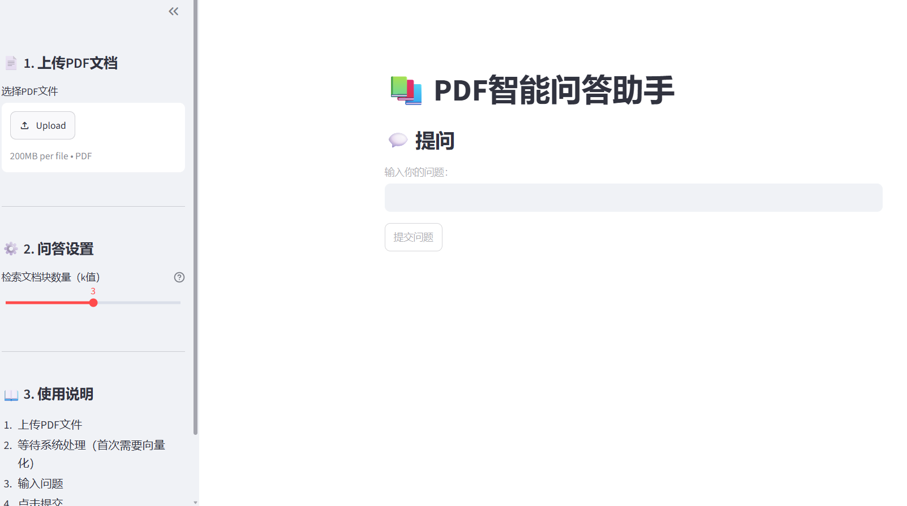

# PDF问答助手

上传 PDF 文档，用自然语言提问，AI 从文档中检索并回答。

## 核心功能

- 📄 支持 PDF 文档上传与解析
- 🔍 基于 RAG 架构的智能检索
- 💬 自然语言问答交互
- 📊 内置检索效果评估体系
- 🌐 提供 HTTP API，其他程序可调用
- ⚡ 流式输出（SSE），支持打字机效果
- 🐳 Docker 容器化，一键部署

## 技术栈

**核心框架：**
- Python 3.10+
- LangChain（RAG 流程编排）
- FastAPI（HTTP 服务）
- Streamlit（Web 界面）

**数据与模型：**
- Chroma（向量数据库，持久化存储）
- 智谱 GLM-4（大模型）
- 智谱 GLM-Rerank（精排优化）

**工程化：**
- Docker（容器化部署）
- loguru（日志系统）
- python-dotenv（配置管理）

## 快速开始

### 方式 1：本地运行

\`\`\`bash
pip install -r requirements.txt
uvicorn app.main:app --reload
\`\`\`

访问 `http://127.0.0.1:8000/docs` 查看 API 文档。

### 方式 2：Docker 运行

\`\`\`bash
docker build -t pdf-qa-api .
docker run -p 8000:8000 pdf-qa-api
\`\`\`

### 方式 3：Streamlit 界面

\`\`\`bash
streamlit run app.py
\`\`\`

## API 接口

| 方法 | 路径 | 说明 |
|------|------|------|
| GET | `/health` | 健康检查 |
| GET | `/api/ping` | 连通性测试 |
| POST | `/api/chat` | 同步问答 |
| POST | `/api/chat/stream` | 流式问答（SSE） |

## 在线体验

[https://pdf-app-assistant-xogchwtvcwzl4dv88wmljj.streamlit.app/](https://pdf-app-assistant-xogchwtvcwzl4dv88wmljj.streamlit.app/)

## 项目截图

## 评估结果

### 评估体系演进

- **v1（19 题，单一 PDF）**：初版评估，文档短、题目简单，Rerank 无提升
- **v2（58 题，3 份 PDF，4 档难度）**：重建评估集，覆盖不同类型文档和难度

使用 58 道问题、3 份 PDF（Transformer 论文、GLM-4 技术报告、LangChain Agents 文档）测试检索效果（Top-5 Hit Rate）。

| 测试集 | 检索方式 | Top-5 命中率 |
|--------|----------|--------------|
| v1（19 题，单一 PDF） | 纯 Chroma | 73.68% |
| v1（19 题，单一 PDF） | Chroma + Rerank | 73.68% |
| **v2（58 题，3 份 PDF）** | **纯 Chroma** | **55.17%** |
| **v2（58 题，3 份 PDF）** | **Chroma + Rerank** | **67.24%** |

**结论：** v1 测试集区分度不足，Rerank 无提升；重建 v2 后，Rerank 将 Top-5 命中率提升 **+12.07%**。

**观察：** Rerank 在 GLM-4 报告上从 65% 降到 55%，说明 Rerank 效果依赖文档结构——在相似术语密集的技术报告中，重排序可能引入噪声。

### 按 PDF 分

| PDF | 纯 Chroma | Chroma + Rerank |
|-----|-----------|-----------------|
| attention_is_all_you_need.pdf | 40.00% | 60.00% |
| glm4_report.pdf | 65.00% | 55.00% |
| langchain_agents.pdf | 61.11% | 88.89% |

### 按难度分

| 难度 | 纯 Chroma | Chroma + Rerank |
|------|-----------|-----------------|
| easy | 58.82% | 76.47% |
| cross_paragraph | 47.06% | 70.59% |
| vague | 66.67% | 60.00% |
| distractor | 44.44% | 55.56% |

## 项目亮点

- **分层架构**：`app/`（FastAPI）+ `core/`（基础设施）+ `services/`（业务逻辑），Streamlit 和 FastAPI 共用同一套 service 层
- **流式输出**：基于 SSE 的 `/api/chat/stream` 接口，前端可实现打字机效果
- **容器化部署**：Dockerfile + .dockerignore，一键构建镜像
- **可观测性**：loguru 日志系统，中间件记录每次请求的方法、路径、状态码、耗时
- **评估体系**：v1→v2 迭代，Top-5 命中率可量化追踪

## 项目结构

\`\`\`text
pdf-qa-assistant/
├── app/                        # FastAPI 服务
│   ├── main.py                 # 入口
│   ├── api/routes.py           # 路由
│   └── schemas/chat.py         # 请求/响应模型
├── core/
│   └── logging.py              # loguru 日志配置
├── services/                   # 业务逻辑层
│   ├── llm.py                  # LLM 初始化
│   ├── pdf.py                  # PDF 处理
│   └── rag.py                  # 检索 + 生成
├── data/
│   ├── pdf/                    # 原始 PDF
│   ├── v1/                     # v1 测试集
│   └── v2/                     # v2 测试集
├── app.py                      # Streamlit 入口
├── build_index.py              # 向量库构建
├── evaluate.py                 # v1 评估
├── evaluate_v2.py              # v2 评估
├── evaluate_with_rerank.py     # v1 Rerank 评估
├── Dockerfile                  # 容器化配置
├── .dockerignore
├── requirements.txt
└── README.md
\`\`\`